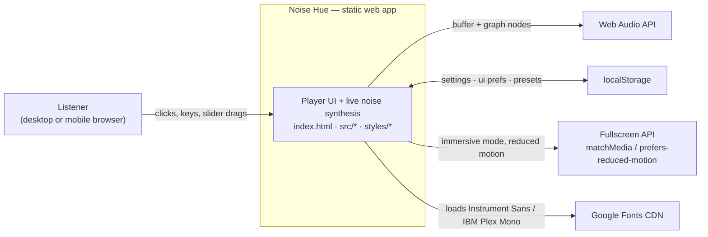
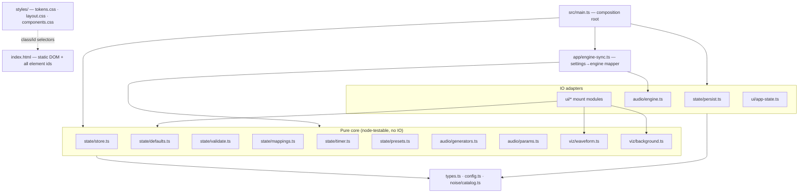
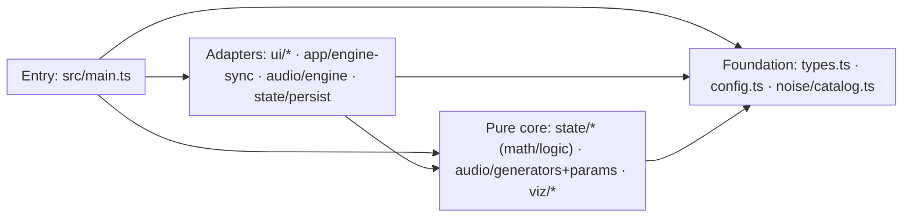
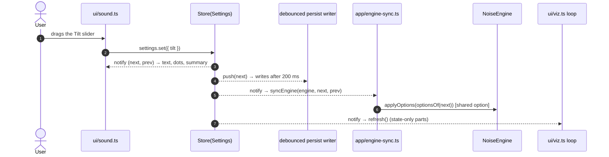
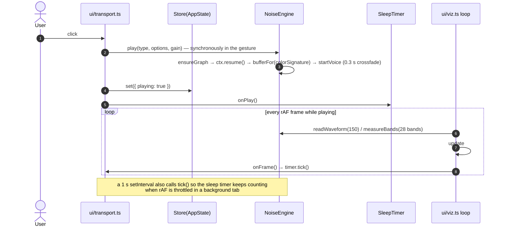
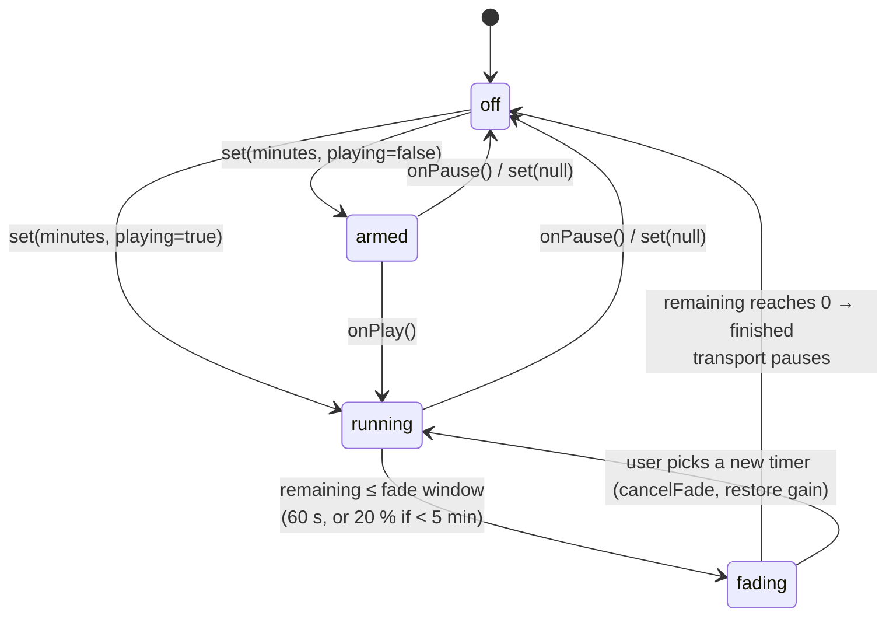

# Project Architecture Blueprint — Noise Hue

> **Status:** Living reference. Generated 2026-10-13 at commit `71c0799` from the code as it exists,
> not from a template. Where this document and the code disagree, the code wins — then fix this file.
>
> **Related docs:** `AGENTS.md` (agent/maintainer rules), `docs/superpowers/specs/2026-10-13-noisehue-design.md`
> (design spec), `docs/superpowers/plans/2026-10-13-noisehue-v1.md` (task-by-task build plan),
> `docs/prototype/prototype-docked.dc.html` (look/behavior source of truth), `docs/qa-checklist.md` (manual QA).

**Generated configuration:** PROJECT_TYPE = Vanilla TypeScript + Vite (auto-detected), ARCHITECTURE_PATTERN =
Layered "pure core / imperative shell" with ports at IO boundaries (auto-detected), DIAGRAM_TYPE = C4-style
(Mermaid), DETAIL_LEVEL = Comprehensive, code examples / implementation patterns / decision records /
extensibility guidance = included.

---

## 1. Architecture Detection and Analysis

### 1.1 Technology inventory

| Concern                | Technology                                                                       | Evidence                                                |
| ---------------------- | -------------------------------------------------------------------------------- | ------------------------------------------------------- |
| Language               | TypeScript ~6.0.3, ES2022, strict                                                | `tsconfig.json`                                         |
| Build/dev server       | Vite ^8.3.4                                                                      | `package.json`, `vite.config.ts`                        |
| Runtime dependencies   | **None**                                                                         | `package.json` has only `devDependencies`               |
| UI                     | Hand-written DOM code on static `index.html` markup; no framework, no templating | `index.html` (914 lines), `src/ui/*`                    |
| Audio                  | Web Audio API (live synthesis)                                                   | `src/audio/engine.ts`, `src/audio/generators.ts`        |
| Persistence            | `localStorage` (injected as `StorageLike`)                                       | `src/state/persist.ts`                                  |
| Tests                  | Vitest ^5.0.4; default `node` env, jsdom 30 opt-in                               | `vite.config.ts`, `// @vitest-environment jsdom` pragma |
| Lint/format            | ESLint 10 + typescript-eslint 8, Prettier 3                                      | `eslint.config.js`, `.prettierrc`                       |
| Doc/test asset loading | Vite `?raw` import of `index.html`                                               | `src/main.dom.test.ts` and all `*.dom.test.ts`          |
| Deployment target      | Static `dist/` on any static host                                                | `npm run build`, README                                 |

There is no backend, no network request from app code (`fetch`, `WebSocket`, `sendBeacon` absent), no
authentication, no analytics, and no runtime package resolution — the shipped bundle is self-contained
except for Google Fonts `<link>` tags in `index.html`.

### 1.2 Pattern determination

Folder layout (`app/`, `audio/`, `noise/`, `state/`, `ui/`, `viz/`) plus the import graph show a
**layered architecture with a pure core and an imperative shell**:

- Pure, deterministic modules (`state/*` except persistence IO, `audio/generators.ts`, `audio/params.ts`,
  `viz/*`, `noise/catalog.ts`) contain all rules and math. They run unmodified under Node.
- Adapter modules (`audio/engine.ts` → Web Audio, `state/persist.ts` → localStorage, `ui/*` → DOM) hold
  every side effect behind narrow interfaces (`ContextFactory`, `StorageLike`, `Store`, `EnginePort`,
  `SyncPort`, `VizEngine`).
- One application service (`app/engine-sync.ts`) maps domain state changes to engine operations.
- One composition root (`main.ts`) instantiates and connects everything. No module constructs its own
  collaborators except the engine's default `AudioContext` factory and persistence's storage argument,
  both of which are injectable.

It is a classic "functional core, imperative shell" adaptation of layered/hexagonal ideas, sized to a
single-page app — not a textbook Clean Architecture with use-case classes, and deliberately so (see
ADR-003).

### 1.3 Evidence summary

- Dependency direction is consistently outward-in: `main.ts` → `ui/`, `app/`, `state/`, `audio/`, `viz/`;
  `ui/` → `state/` + `viz/` + (`import type`) `audio/`; `state/` → `types.ts`/`config.ts`/`catalog.ts`.
- No cycles exist between subsystems.
- Pure modules never import DOM/Web Audio/localStorage.
- All cross-boundary collaborators are injectable: `createPersistence(storageOrNull())`,
  `new NoiseEngine(factory)`, `createSleepTimer(() => performance.now())`, `makeNoiseChannel(..., rand)`,
  `mountPresets(..., makeId)`.
- The audio engine explicitly does not compute volume: `// Receives gains; never computes volume curves.`

---

## 2. Architectural Overview

**In one sentence:** a statically hosted, framework-free browser app in which four typed stores hold all
state, pure modules compute everything that can be computed, and thin `mount*`/`bind*` adapters translate
store changes into Web Audio node parameters and DOM writes.

**Guiding principles (visible in the code):**

1. **Pure core.** Rules live in functions that take values and return values; Node tests cover them
   without DOM or Web Audio. (`state/timer.ts`, `state/mappings.ts`, `state/presets.ts`,
   `audio/generators.ts`, `audio/params.ts`, `viz/*`.)
2. **One way to change state.** Components never mutate each other; they call `store.set(...)`.
   Subscribers react. (`state/store.ts`.)
3. **Wiring is explicit and centralized.** Only `main.ts` creates stores, engine, timer and UI mounts;
   `app/engine-sync.ts` is the only place that decides _how_ a settings diff becomes engine calls.
4. **Narrow ports at the edges.** The DOM layer sees `EnginePort`/`SleepTimer`/`Store`, not the engine
   class; the engine sees gains and `SoundOptions`, not `Settings`.
5. **YAGNI.** Unused prototype variants are recorded as constants (`CONFIG.warpWaves`, `CONFIG.dotAnim`,
   band/mirror math) rather than implemented.
6. **Zero runtime dependencies.** Any package addition needs a strong reason (AGENTS.md).
7. **Failure is silent and local.** No Web Audio → inline notice + disabled controls; storage blocked →
   defaults; corrupt stored field → that field's default. The app never throws at the user.
8. **Continuous rendering is explicit.** One rAF loop owns all per-frame work; every DOM writer no-ops
   when the value is unchanged.

**Boundaries and how they are enforced:**

| Boundary          | Rule                                                     | Enforcement today                                                                                  |
| ----------------- | -------------------------------------------------------- | -------------------------------------------------------------------------------------------------- |
| pure ↔ IO         | No DOM/Web Audio/localStorage imports in pure modules    | Convention + code review; tests run in `node` env (a stray DOM call would fail)                    |
| UI ↔ engine       | UI talks only to port types                              | Structural typing via `Pick<NoiseEngine, ...>`; no test imports the engine from `ui/` except types |
| settings ↔ engine | Only `engine-sync.ts` maps settings to engine calls      | Single module owns the mapping; tests pin it                                                       |
| markup ↔ JS       | Element IDs are a frozen contract; `$()` throws on drift | `$()` throws; DOM tests load the real `index.html?raw` so markup drift breaks tests                |

**Hybrid/adaptation notes:** the store is a tiny hand-rolled observer (not Redux/EF-style); persistence is
a repository-like module but with per-field sanitize-on-read instead of a schema layer; the sleep timer is
a state machine but exposes a polled `tick()` for a rAF-driven UI rather than emitting events.

---

## 3. Architecture Visualization

### 3.1 C4 Level 1 — System context



### 3.2 C4 Level 2 — Containers / subsystems



### 3.3 Dependency-direction view (allowed imports)



### 3.4 Data flow — a settings change



A **color-specific** option instead calls `engine.regenerate(type, options)` (250 ms debounced inside the
engine); a **type** change calls `engine.switchTo` while playing plus `regenerate`; **volume/mute** calls
`engine.setLevel(volumeGain(...), 0.05)`.

### 3.5 Data flow — play + render loop



### 3.6 Sleep-timer flow



---

## 4. Core Architectural Components

### 4.1 Composition root — `src/main.ts`

- **Purpose:** the only wiring point. Turns the module graph into a running app and defines process-level
  lifecycle (debounced saves + flush on `pagehide`/hidden, 1 s timer interval, reduced-motion listener).
- **Internal structure:** `storageOrNull()` (safe storage access), `debounced<T>()`, `silentEngine`
  fallback + `disableAudioControls()`, then `main()`: persistence → 4 stores → engine → UI mounts → viz.
- **Interaction:** subscribes `engine-sync` to `Settings`; passes stores into each `mount*`; passes
  `transport.tick` as `mountViz`'s `onFrame`.
- **Evolution:** new subsystems are added here; keep it wiring-only (no business rules). New global
  lifecycle concerns (e.g. visibility handling) belong here.

### 4.2 Domain model and catalog

- **Purpose:** the vocabulary of the app. `types.ts` defines `NoiseId`, `SoundOptions`, `Settings`,
  `UiPrefs`, `Preset`, `ColorOptionKey`. `noise/catalog.ts` defines the 8 colors (name, swatch, slope
  label, description, tilt, optional `base` generator) and the **color-option ownership map**
  `COLOR_OPTION_KEYS`. `config.ts` holds fixed prototype "tweaks".
- **Internal structure:** data tables plus small accessors: `getNoise(id)` (throws on unknown id),
  `colorKeysFor(id)`, and the derived `ALL_COLOR_OPTION_KEYS` / `COLORS_WITH_OPTIONS` lists that keep
  engine-sync, the change summary and the sound panel in step with the catalog.
- **Interaction:** imported by nearly every layer; no imports of its own except `types.ts`.
- **Evolution:** `COLOR_OPTION_KEYS` is the single source of truth for which `SoundOptions` fields are
  color-specific; it drives buffer cache signatures (`colorSignature`), regeneration decisions
  (`engine-sync`) and the UI change summary (`changeSummary`); validation iterates `OPTION_KEYS`.

### 4.3 State layer — `src/state/`

| Module        | Responsibility                                                                                                    | Key exports                                                                                                                                                    |
| ------------- | ----------------------------------------------------------------------------------------------------------------- | -------------------------------------------------------------------------------------------------------------------------------------------------------------- |
| `store.ts`    | Minimal synchronous observable store; shallow patch compare (`Object.is` per key), no notify when nothing changed | `createStore<T>`, `Store<T>`                                                                                                                                   |
| `defaults.ts` | Single place for defaults, ranges, caps                                                                           | `OPTION_DEFAULTS`, `OPTION_KEYS`, `OPTION_LIMITS`, `DEFAULT_SETTINGS`, `DEFAULT_UI`, `VOLUME_LIMITS`, `SLEEP_MINUTES_LIMITS`, `MAX_PRESETS`, `MAX_PRESET_NAME` |
| `validate.ts` | **Field-level** sanitize of untrusted persisted data; iterates defaults so new fields are covered automatically   | `sanitizeSettings`, `sanitizeUi`, `sanitizePresets`                                                                                                            |
| `persist.ts`  | localStorage adapter behind `StorageLike`; JSON read/write with try/catch; one-shot legacy migration              | `createPersistence(storage)`, `Persistence`                                                                                                                    |
| `mappings.ts` | Volume dB curve, slider log scales, display strings, status text/color, change summary                            | `volumeGain`, `logScale` presets, `*Text`, `statusText`, `statusColor`, `changeSummary`                                                                        |
| `timer.ts`    | Pure sleep-timer state machine with injected clock                                                                | `createSleepTimer(now)`, `fadeSecondsFor`, `formatRemaining`                                                                                                   |
| `presets.ts`  | Immutable preset-list operations and Settings↔SoundOptions shape projection                                       | `nextPresetName`, `normalizeName`, `addPreset`, `removePreset`, `optionsOf`, `findActivePreset`                                                                |

- **Interaction:** stores are created in `main.ts`, rendered by UI subscribers, persisted via debounced
  writers, and consumed by `engine-sync`.
- **Evolution:** a new persisted preference touches `types.ts` → `defaults.ts` → `validate.ts` →
  `persist.ts` → `main.ts` (store + save) → UI. A new option touches `defaults.ts` and is validated
  automatically.

### 4.4 Application service — `src/app/engine-sync.ts`

- **Purpose:** the single translation from a `Settings` diff to engine operations. Classifies option keys
  into color-specific (`COLOR_OPTION_KEYS`) vs shared (everything else) and invokes the engine
  accordingly; also computes volume gain with the 50 ms ramp.
- **Interaction:** `bindEngine(settings, engine)` subscribes to the settings store; the engine side is a
  `SyncPort = Pick<NoiseEngine, 'switchTo' | 'regenerate' | 'applyOptions' | 'setLevel' | 'playing'>`.
- **Evolution:** adding a `SoundOptions` field automatically lands in `SHARED_KEYS` unless listed in
  `COLOR_OPTION_KEYS`; type-change semantics and debounce/replace behavior are pinned by
  `engine-sync.test.ts`.

### 4.5 Audio subsystem — `src/audio/`

- **Purpose:** produce the sound. `generators.ts` is pure DSP (noise synthesis per color, RBJ biquad
  coefficients/filtering/magnitude, ideal response curve, cache signature). `params.ts` is pure
  option→graph-parameter math (width matrix, tilt shelves, wave LFO). `engine.ts` owns the Web Audio
  graph, voices, buffer cache, crossfades, analysis and the timer fade.
- **Graph (spec §5):**

  ```text
  BufferSource (8 s stereo loop, seam-crossfaded)
    → voice gain (0.3 s crossfade)
    → master gain (volume + mute)
    → width matrix (split → wAL/wAR/wBL/wBR → merge; L = c·a + s·b, R = c·a − s·b)
    → lowCut (HP Q .707) → highCut (LP Q .707)
    → tiltLow (lowshelf 800 Hz, −t/2) → tiltHigh (highshelf 1250 Hz, +t/2)
    → waveGain (LFO 1/period Hz, depth/2)
    → timerGain (only fadeOut touches this)
    → StereoPanner (feature-detected) → Analyser (fft 8192, smoothing 0.85) → destination
  ```

- **Interaction:** gains and `SoundOptions` in; buffers, analysis arrays, and promises out
  (`play(): Promise<void>`, `fadeOut(): Promise<'done' | 'cancelled'>`). The engine never imports
  `state/`.
- **Key mechanics:** buffers cached by `colorSignature(id, options)` with LRU cap 10; color-specific
  regeneration debounced 250 ms (`regenerate`); rapid switches keep at most one active + one outgoing
  voice; `pause()` ramps to 0, stops voices after 500 ms, restores `timerGain` silently and suspends the
  context; `readWaveform` decimates 2048 samples; `measureBands` averages
  10^(dB/10) per band with 0.8/0.2 smoothing.
- **Evolution:** extend by adding pure math to `params.ts`/`generators.ts` first, graph nodes in
  `ensureGraph`, public operations on `NoiseEngine`, and a test in `engine.test.ts` using the fake context.

### 4.6 Visualization subsystem — `src/viz/` + `src/ui/viz.ts`

- **Purpose:** draw the waveform, compare curves and page glow; own the single rAF loop.
- **Pure builders:** `waveform.ts` (600×160 viewBox, midline 80, 28 log bands 40 Hz–16 kHz, ideal curve
  from `idealDb`, measured line/area offset to the ideal average), `background.ts` (layered radial
  gradient glow, strength squared, eased stops, `#0E1116` base).
- **Loop (`ui/viz.ts`):** modes `live` (per frame while playing), `motion` (≤ 30 fps while stopped and
  audible), `idle` (stops after one render). Owns `is-live`, `ring-ripple`, compare overlay
  content, `#app` background diffing, and calls `onFrame` (the timer tick) only from loop-drawn frames.
- **Interaction:** reads stores; calls the engine through `VizEngine = Pick<NoiseEngine, 'readWaveform' |
'measureBands' | 'playing'>`; caches ideal curves by `Settings` object identity.
- **Evolution:** new per-frame visuals belong inside `draw`/`frame` to preserve the single-loop rule;
  new pure geometry belongs in `viz/` with its own node test.

### 4.7 UI subsystem — `src/ui/`

- **Purpose:** DOM behavior and rendering for every region: panels, colors, sound, presets, transport,
  immersive, timer popover, viz loop. `dom.ts` provides throwing `$()` and no-op-when-unchanged writers;
  `app-state.ts` defines transient `AppState` (`playing`, `compare`, `immersive`, `peekType`,
  `suppressLeft/Right`, `timerLabel`).
- **Internal structure:** each module exports a `mount*` function that queries its elements once, binds
  listeners, defines a `render()`, subscribes it, and renders once. `mountTransport` returns `{ tick }`;
  `mountTimerPopover` returns `{ sync }`; `mountViz` returns `{ refresh }`.
- **Interaction:** stores in, DOM out. Modules never call each other; cross-module effects travel through
  stores (`peekType`, `playing`, `compare`, `immersive`). `transport`, `immersive` and `viz` share the
  `AppState` store instead of direct references.
- **Accessibility & keyboard behavior (cross-cutting in this layer):** `aria-pressed`/`aria-expanded`/
  `aria-label`/`aria-valuetext` updates, a polite live region for status, focus management on panel
  collapse, timer popover Esc/return-focus, immersive "any key exits" (Tab/modifiers pass through), IME
  composition guard in the preset name input.
- **Evolution:** add a `mountX` module, keep IDs in `index.html` stable, subscribe to the stores it needs,
  and wire it in `main.ts`. If it needs frame time, hook into `mountViz`'s loop rather than starting a
  second `requestAnimationFrame` chain.

### 4.8 Static shell — `index.html` + `styles/`

- **Purpose:** all structure and visual design live in markup/CSS; JS only toggles classes, attributes,
  text and CSS variables.
- **Structure:** `styles/tokens.css` (44 lines, custom properties/fonts), `styles/layout.css` (309 lines,
  grid/rails/mobile/fullscreen), `styles/components.css` (1329 lines, buttons/sliders/chips/popover/
  animations). Breakpoints at 62.5em (desktop↔mobile), 50em, 31.25em. Runtime accent via `--accent` set by
  `ui/colors.ts`.
- **Contract:** ~90 element IDs and class hooks (`is-collapsed`, `is-suppressed`, `is-folded`,
  `is-immersive`, `is-audible`, `desc-peek`, `play-ripple`, `ring-ripple`, `dot-bounce-a/b`) are the JS/CSS
  interface; DOM tests import the real markup, so drift is caught.

---

## 5. Architectural Layers and Dependencies

### 5.1 Layer map

| Layer                | Modules                                                                                              | May import | Must not import                                                 |
| -------------------- | ---------------------------------------------------------------------------------------------------- | ---------- | --------------------------------------------------------------- |
| L0 Foundation        | `types.ts`, `config.ts`, `noise/catalog.ts`                                                          | —          | anything                                                        |
| L1 Pure core         | `state/{store,defaults,validate,mappings,timer,presets}.ts`, `audio/{generators,params}.ts`, `viz/*` | L0         | DOM, Web Audio, localStorage, `ui/`, `app/`                     |
| L2 Adapters/services | `state/persist.ts`, `audio/engine.ts`, `app/engine-sync.ts`, `ui/*`                                  | L0, L1     | other L2 modules except type-only ports and `ui/dom.ts` helpers |
| L3 Composition       | `main.ts`                                                                                            | everything | —                                                               |

### 5.2 Dependency rules and abstractions

- **Direction:** always toward L0; nothing in L0/L1 imports upward. `main.ts` is the only module allowed to
  know every subsystem.
- **Abstraction mechanisms:** generic `Store<T>`; port types via `Pick<NoiseEngine, ...>`; injected
  factories (`ContextFactory`), values (`StorageLike`, `now`, `rand`, `makeId`); pure functions instead of
  classes for rules.
- **No circular dependencies** exist. Shared helpers are pushed down (e.g. `optionsOf` in
  `state/presets.ts` is imported by both `app/` and `ui/`).
- **Intentional boundary crossings (accepted, keep in mind):**
  1. `viz/waveform.ts` imports `idealDb` from `audio/generators.ts` — the drawn ideal curve must be the
     same math as the generated sound; both are pure, so this is a shared-math dependency, not an IO leak.
  2. `state/mappings.ts` contains user-visible strings (`'Center'`, `'+3 dB brighter'`) — presentation
     rules deliberately live next to the value mappings they describe rather than in `ui/`.
  3. `ui/colors.ts` and `ui/viz.ts` each query the color buttons independently to attach different
     behavior (selection vs. ripple swatch). Duplication is two lines; a shared registry is not worth it.
- **Enforcement status:** there is no import-boundary lint rule. The boundary is held by convention,
  `AGENTS.md`, and the fact that L1 code is executed in Node by the default Vitest environment (DOM calls
  there fail loudly).

---

## 6. Data Architecture

### 6.1 Domain model

| Type                            | Shape                                                                                                                                                                                | Persisted                            | Notes                                                        |
| ------------------------------- | ------------------------------------------------------------------------------------------------------------------------------------------------------------------------------------ | ------------------------------------ | ------------------------------------------------------------ |
| `SoundOptions`                  | 13 flat numeric fields (`tilt`, `lowCut`, `highCut`, `width`, `pan`, `waveDepth`, `wavePeriod`, `brownCorner`, `greenCenter`, `greenWidth`, `greyStrength`, `orangeQ`, `orangeTune`) | inside `Settings` / `Preset.options` | Flat on purpose: single source for defaults/limits/iteration |
| `Settings extends SoundOptions` | + `type: NoiseId`, `volume`, `muted`                                                                                                                                                 | `noisehue:settings`                  | One store, whole-object immutable updates                    |
| `UiPrefs`                       | `pinLeft`, `pinRight`, `foldLeft`, `foldRight`, `sleepMinutes`                                                                                                                       | `noisehue:ui`                        | Panel layout + last timer choice                             |
| `Preset`                        | `{ id, name, type, options: SoundOptions }`                                                                                                                                          | `noisehue:presets` (array)           | Never includes volume/mute                                   |
| `AppState`                      | transient: `playing`, `compare`, `immersive`, `peekType`, `suppressLeft/Right`, `timerLabel`                                                                                         | no                                   | Runtime only; reset on reload                                |
| `NoiseInfo`                     | catalog metadata per color                                                                                                                                                           | static code                          | `base` selects the generator family                          |

### 6.2 Shape transformations

- **Flat ↔ nested:** `optionsOf(settings)` projects the flat `Settings` into `SoundOptions` for the engine
  and presets; applying a preset spreads `{ type, ...preset.options }` back into the flat store. This is
  the only model-shape conversion in the app.
- **Derived data is never stored:** volume gain, status text/color, changed counts, ideal curves, slider
  positions, formatted labels are all computed on render.

### 6.3 Data access and persistence lifecycle

1. **Read:** `createPersistence(storage)` → `storage.getItem` in try/catch → `JSON.parse` in try/catch →
   `sanitize*` → defaults for anything invalid. Legacy keys (`noise-app-config`, `noise-app-panes`) are
   imported **once**, only when the new key is absent, never modified or deleted.
2. **Write:** stores notify on change; `main.ts` debounces writes 200 ms per store and flushes on
   `pagehide` and on `visibilitychange → hidden` (mobile safety). Preset writes go through
   `mountPresets(..., save)` immediately (list changes are discrete, not continuous).
3. **Failure policy:** blocked/quota-throwing storage means _don't save_, never an error. `createPersistence(null)`
   is a valid no-op store.

### 6.4 Validation patterns

- Defaults and limits are colocated (`OPTION_DEFAULTS`, `OPTION_KEYS`, `OPTION_LIMITS`); `sanitizeOptions`
  iterates the defaults object, so **new fields are validated automatically** once added.
- Scalars: must be finite numbers inside the inclusive range, else default. Booleans: type check.
  Noise ids: membership in the catalog, else default. Presets: malformed entries dropped individually;
  ids de-duplicated (the UI keys chips by id); names trimmed and capped; array truncated to `MAX_PRESETS = 20`.
- Runtime input (slider values) is bounded by HTML range + `OPTION_LIMITS`; timer custom input validates
  integers within `SLEEP_MINUTES_LIMITS` and sets `aria-invalid`.

### 6.5 Caching and performance data structures

| Cache                   | Location                       | Policy                                                               |
| ----------------------- | ------------------------------ | -------------------------------------------------------------------- |
| Noise buffers           | `NoiseEngine.buffers`          | keyed by `colorSignature(id, options)`; LRU eviction over 10 entries |
| Regeneration intent     | `NoiseEngine.regenTimer`       | single 250 ms debounce; replaced by newer request                    |
| Ideal compare curve     | `ui/viz.ts` `idealFor`/`ideal` | recomputed only when the `Settings` object identity changes          |
| Background string       | `ui/viz.ts` `bgText`           | DOM write skipped when identical                                     |
| Text/attribute writes   | `ui/dom.ts` writers            | no-op when unchanged                                                 |
| Measured band smoothing | `NoiseEngine.bands`            | 0.8/0.2 exponential smoothing                                        |

No IndexedDB, no service worker, no in-memory cache of DOM nodes beyond the mount functions' closures.
Concurrency is the browser event loop: store notifications are synchronous and reentrant-safe (`[...subs]`
copy during dispatch); storage is last-write-wins per key; audio scheduling uses `AudioParam` timelines
(`setTargetAtTime`, `linearRampToValueAtTime`) rather than locks.

---

## 7. Cross-Cutting Concerns

### 7.1 Authentication, authorization, security

- **Model:** none — no accounts, no server, no network calls. All data stays in the user's `localStorage`.
- **Trust boundary:** persisted JSON is untrusted input and is sanitized field-by-field on read.
- **Injection safety:** state is written with `textContent`/`setAttribute`/`classList`/`style.setProperty`
  only; there is no `innerHTML`, `insertAdjacentHTML`, or dynamic script. Preset chips are built with
  `document.createElement`.
- **Privacy:** no analytics or telemetry; the only external requests are the Google Fonts stylesheet and
  font files declared in `index.html`.
- **Surface notes:** fullscreen and audio-context activation require user gestures; `crypto.randomUUID` is
  used when available with a non-crypto fallback.

### 7.2 Error handling and resilience

| Failure                                                   | Handling                                                                                                                       | Code                                    |
| --------------------------------------------------------- | ------------------------------------------------------------------------------------------------------------------------------ | --------------------------------------- |
| Web Audio absent                                          | `NoiseEngine.isSupported()` false → `silentEngine`, show `#unsupported`, disable `#play/#timer-btn/#mute/#vol`                 | `main.ts`                               |
| `AudioContext` constructor throws despite support check   | `try/catch` around `engine.play` → show `#unsupported`                                                                         | `ui/transport.ts`                       |
| `ctx.resume()` rejects                                    | pause again if still playing in the same session (`session` counter prevents stale pauses)                                     | `ui/transport.ts`                       |
| Pause during timer fade                                   | fade resolves `'cancelled'`; `timerGain` holds its value until voices stop (no volume swell); restored on next play            | `audio/engine.ts`                       |
| Rapid color switching                                     | at most one active + one outgoing voice; outgoing cut when replaced; buffers LRU-bounded                                       | `audio/engine.ts`                       |
| Stale fade resolution after replays                       | `session` counter compared before pausing                                                                                      | `ui/transport.ts`                       |
| Storage blocked/quota/corrupt JSON                        | try/catch on all access; field-level fallback to defaults                                                                      | `state/persist.ts`, `state/validate.ts` |
| Fullscreen refused/unavailable                            | immersive mode still works in-page; `requestFullscreen().catch(() => {})`                                                      | `ui/immersive.ts`                       |
| Exited immersive while `requestFullscreen()` is in flight | the late resolution leaves browser fullscreen again (`leaveBrowserFullscreen()`)                                               | `ui/immersive.ts`                       |
| `color-mix` unsupported                                   | CSS fallback border                                                                                                            | `styles/components.css`                 |
| Background tab throttles rAF                              | 1 s `setInterval` keeps the sleep timer counting                                                                               | `main.ts`                               |
| Reduced motion                                            | motion, ripples, dot animation, ring pulse and transitions disabled via `prefers-reduced-motion`; `motionWobble` returns zeros | CSS + `viz/background.ts`, `ui/viz.ts`  |

No retries, circuit breakers, or crash reporting exist — there is nothing remote to retry or report to.

### 7.3 Logging and monitoring

Deliberate absence: no `console.*`, no analytics, no performance instrumentation in application code.
Diagnostics are structural instead: pure functions are unit-testable, the engine is observable through its
injected fake context, and manual QA is codified in `docs/qa-checklist.md`. If diagnostics are ever added,
route them through one module rather than sprinkling `console.log`.

### 7.4 Validation

See §6.4. Responsibilities: parser/sanitizer owns stored-data validity (`state/validate.ts`); UI owns input
constraints (HTML `min/max/step`, timer integer check, preset name length); engine assumes valid typed
options and only guards its own lifecycle.

### 7.5 Configuration management

Three separate mechanisms, deliberately not merged:

| Mechanism                              | Contents                                                                                                                          | Changed by                                  |
| -------------------------------------- | --------------------------------------------------------------------------------------------------------------------------------- | ------------------------------------------- |
| `src/config.ts` (`CONFIG`, `as const`) | Fixed prototype "tweaks": start color, dB floor, glow params, motion mode/speed/intensity, ripple/dot variants, waveform behavior | Developers only; **not user settings**      |
| `state/defaults.ts`                    | User-facing defaults, ranges, limits, caps                                                                                        | Developers; drives validation and UI ranges |
| `localStorage` (`noisehue:*`)          | Current user values                                                                                                               | The user, via the UI                        |

There are no environment variables or build-time flags; `import.meta.env` is unused. Some `CONFIG` entries
(`warpWaves`, `dotAnim`, `waveBacking`, `minHeight/maxHeight/center`) are intentionally unused records of
the chosen prototype variant (spec §2) — do not delete them as "dead code", and do not implement their
alternatives without a spec change.

### 7.6 Accessibility (de facto cross-cutting requirement)

- Semantic buttons/inputs; `aria-pressed`, `aria-expanded`, `aria-valuetext`, `aria-label` kept in sync by
  render functions.
- Status changes announced through a polite live region; the per-minute countdown is `aria-hidden` while
  the timer button's label carries it.
- Keyboard: Esc closes popover/fullscreen; focus returns to the triggering button; Tab into a collapsed
  rail opens the panel; immersive mode exits on any non-modifier key.
- `prefers-reduced-motion` respected for all animation; touch targets sized for mobile in CSS.

---

## 8. Service Communication Patterns

There are no remote services; "communication" is in-process. Four mechanisms, each used for a reason:

| Mechanism                     | Where                                                                  | Semantics                                                                                        |
| ----------------------------- | ---------------------------------------------------------------------- | ------------------------------------------------------------------------------------------------ |
| Store subscription (observer) | UI modules, `engine-sync`, persistence debouncers                      | Synchronous fan-out of immutable state replacements; `(next, prev)` arguments let consumers diff |
| Direct call                   | `transport` → engine ports; `viz` → engine ports; UI handlers → stores | Synchronous, typed by `Pick<>` ports                                                             |
| Promises                      | `play()` (resume), `fadeOut()` (completion/cancellation)               | Only where a browser API is async; cancellation is a first-class result (`'cancelled'`)          |
| Pull (poll) per frame         | `ui/viz.ts` → engine analysers + stores; `transport.tick()`            | rAF-paced polling avoids high-frequency store churn from audio data                              |

**Boundary definitions:** `Store<T>` (state), `EnginePort`/`SyncPort`/`VizEngine` (audio capabilities),
`SleepTimer` (temporal behavior), `Persistence` (storage), `ContextFactory`/`StorageLike` (platform).

**Synchronous vs asynchronous:** every state change is synchronous; audio parameter changes are scheduled
on the AudioParam timeline with time constants (0.03–0.3 s) for glitch-free transitions. The only async
hand-offs are context resume and the fade, and both carry tokens (`session`, `'cancelled'`) so late
resolutions cannot corrupt later state.

**Versioning:** no API versioning. The persisted schema is versioned implicitly by sanitize + one-shot
legacy-key migration; unknown fields are ignored, invalid fields default.

**Resilience patterns:** debounce/coalesce (saves 200 ms, regeneration 250 ms), latest-wins cancellation
(session counter, replaced regen timer), bounded resources (LRU buffers), graceful degradation
(silent engine), and feature detection (panner, fullscreen, storage).

---

## 9. Technology-Specific Architectural Patterns

Only one stack is present; the framework-specific sections for .NET/Java/React/Angular/Python do not
apply.

### 9.1 Vanilla browser app (Vite + TypeScript)

- **Entry model:** `index.html` declares `<script type="module" src="/src/main.ts">`; `main()` runs at
  module evaluation. No router, no pages — one screen with responsive layouts.
- **Module system:** ESM with `verbatimModuleSyntax`; type-only imports must be `import type`.
- **DOM strategy:** static markup + behavior-attaching `mount*` functions (a tiny manual version of
  progressive enhancement). IDs are the API between markup and code.
- **Rendering strategy:** imperative, fine-grained writes on state change plus one rAF loop for
  continuous visuals; no virtual DOM, no diffing.
- **CSS strategy:** design tokens as custom properties, class toggles driven by JS state, runtime accent
  color as a CSS variable.

### 9.2 Web Audio

- Lazy graph construction on first play (autoplay-policy compliant), suspend on pause, close on dispose.
- Node graph built once per engine instance; changes are parameter ramps, except voice (buffer source)
  replacement for color/regeneration.
- Analysis via a single `AnalyserNode` shared by waveform (time domain) and bands (frequency domain).
- Feature detection for `StereoPannerNode` and `webkitAudioContext`.

### 9.3 Vite

- `vite.config.ts` uses `defineConfig` from `vitest/config` so build and test share one file
  (`test.environment: 'node'`).
- Tests use Vite's `?raw` import for `index.html`; `tsconfig.types: ["vite/client"]` provides its typing
  without `@types/node`.
- Build is `tsc --noEmit && vite build`; there is no custom plugin, alias, or define.

### 9.4 Vitest + jsdom

- Default environment `node` keeps pure-module tests fast and forces DOM tests to declare
  `// @vitest-environment jsdom`.
- `vi.resetModules()` + dynamic `await import('./main')` for the composition root; fake timers and stubbed
  rAF for determinism; `localStorage` cleared/seeded per test.

---

## 10. Implementation Patterns

### 10.1 Interface design

- **Port by projection:** `export type EnginePort = Pick<NoiseEngine, 'play' | 'pause' | ...>` — consumers
  get exactly the capabilities they use; the concrete class stays in `main.ts`.
- **Injected platform seams:** `ContextFactory = () => AudioContext`, `StorageLike = Pick<Storage,
'getItem' | 'setItem'>`, `now: () => number`, `rand?: () => number`, `makeId?: () => string`.
- **Default-argument injection** for optional test seams (`constructor(factory = defaultFactory)`,
  `rand = Math.random`) so production code stays call-site-simple.

### 10.2 State and service patterns

- **Generic store over per-domain classes.** One implementation, four instances (settings, ui, presets,
  app). Whole-state replacement; nested data (preset list) is wrapped (`Store<{ list: Preset[] }>`) and
  replaced immutably.
- **Subscriber render functions are idempotent and cheap:** query elements once at mount, compute values,
  write only what changed.
- **Application service is a pure function over diffs** (`syncEngine(engine, next, prev)`), bound to a
  store with `bindEngine`. Tests call it directly — no store/engine ceremony needed.
- **State machine with an injected clock** for the timer; UI polls `tick()`/`label()`, keeping the machine
  free of timers and DOM.
- **Immutable collection operations** (`addPreset`, `removePreset`) returning new arrays; UI stores them in
  a map keyed by id and reconciles DOM nodes rather than re-rendering the list.

### 10.3 IO adapter patterns

- **Repository-ish persistence:** `Persistence` interface with load/save pairs; construction takes storage;
  parsing and sanitizing are separate pure functions.
- **Engine facade** with lifecycle methods (`play`, `pause`, `switchTo`, `regenerate`, `setLevel`,
  `applyOptions`, `readWaveform`, `measureBands`, `fadeOut`, `cancelFade`, `dispose`) — the UI never
  touches graph nodes.
- **DOM writer helpers** that no-op when unchanged (`setText`, `setAttr`, `toggleClass`, `setVar`) and a
  throwing `$()` for contract violations.

### 10.4 Domain/rendering patterns

- **Single source of truth for derived labels:** mappings module produces value text; UI never formats
  numbers inline.
- **Settings diff classification:** color keys from `colorKeysFor` + behavior key sets (`SHARED_KEYS`) drive
  engine operations. This table _is_ the settings→audio contract.
- **Cancellable async edges:** every promise that can outlive its session is tagged (`session` counter) or
  cancels explicitly (`cancelFade`, `'cancelled'`).

---

## 11. Testing Architecture

### 11.1 Strategy by layer

| Layer            | Test style                                                             | Environment | Examples                                                                                                                                                    |
| ---------------- | ---------------------------------------------------------------------- | ----------- | ----------------------------------------------------------------------------------------------------------------------------------------------------------- |
| L0/L1 pure logic | Unit, exact values                                                     | `node`      | `mappings.test.ts`, `timer.test.ts`, `presets.test.ts`, `validate.test.ts`, `store.test.ts`, `params.test.ts`                                               |
| DSP correctness  | Property/spectral tests with seeded PRNG + Welch PSD                   | `node`      | `generators.test.ts` (slope per color ±1 dB/oct, green band peak, orange notches, RMS/seam/clipping)                                                        |
| Audio adapter    | Behavioral tests against `FakeAudioContext`                            | `node`      | `engine.test.ts` (voice count on rapid switches, fade cancellation, suspend on pause, support detection)                                                    |
| App service      | Diff→calls table tests                                                 | `node`      | `engine-sync.test.ts`                                                                                                                                       |
| viz builders     | String/geometry assertions                                             | `node`      | `waveform.test.ts`, `background.test.ts`                                                                                                                    |
| UI modules       | Integration with real markup `?raw`, jsdom, fake timers                | `jsdom`     | `panels.dom.test.ts`, `colors.dom.test.ts`, `sound.dom.test.ts`, `presets.dom.test.ts`, `transport.dom.test.ts`, `immersive.dom.test.ts`, `viz.dom.test.ts` |
| Composition root | Import `main` after `resetModules`, assert debounced persistence/flush | `jsdom`     | `main.dom.test.ts`                                                                                                                                          |

21 test files / 212 tests. Default env is `node`; every DOM test starts with
`// @vitest-environment jsdom`.

### 11.2 Test doubles and data

- `audio/fake-context.test-util.ts` — minimal Web Audio fake recording created nodes, connect graphs,
  `start/stop`, `AudioParam` events, context state, resume/suspend/close calls. Cast to `AudioContext` only
  at the factory boundary.
- `audio/spectrum.test-util.ts` — seeded PRNG (`mulberry32`), radix-2 FFT, Welch PSD, octave-band slope
  fit. Test-only; never imported by app code.
- Injectables: fake clock (timer), stub engine objects (`satisfies SyncPort`/`EnginePort` with `vi.fn`),
  injected storage objects, injected `makeId`.
- DOM data: real `index.html?raw` parsed into `document.body`; localStorage seeded/cleared per test;
  `requestAnimationFrame` stubbed; `visibilityState` redefined to test flush behavior.

### 11.3 Boundaries and gaps

- **No real Web Audio in tests by rule** (AGENTS.md); no visual snapshot tests; no end-to-end/browser
  automation in the repo. Cross-browser behavior is covered by `docs/qa-checklist.md` manually (Safari,
  Chrome, Firefox, Edge; iOS Safari; Android Chrome).
- The gate: `npm test && npm run lint && npm run build`, run locally (no CI). Node 22 is required; on this
  machine prefix with `export PATH="$HOME/.nvm/versions/node/v22.23.3/bin:$PATH"`.

---

## 12. Deployment Architecture

- **Artifact:** `dist/` produced by `tsc --noEmit && vite build`; fully static HTML/CSS/JS with no server
  counterpart. Vite's default `base: '/'` and root-absolute asset paths (`/styles/*`, `/src/main.ts` in
  dev) mean it must be hosted at a domain root (or a base must be configured before deploying under a
  subpath).
- **Topology:** static host / CDN → browser. No containers, no orchestration, no cloud services, no
  runtime dependency resolution, no environment-specific builds.
- **Runtime environment assumptions:** modern evergreen browser with Web Audio; ES2022 output target;
  `localStorage` optional; Google Fonts reachable (layout degrades gracefully without them).
- **Explicit scope exclusions (v1):** background/lock-screen playback, Media Session, PWA/offline,
  analytics, accounts/sync, hosting/DNS setup. Playback is foreground-only; audio stops if the tab is
  suspended or the phone locks.
- **Configuration across environments:** none. Everything user-adjustable is per-browser `localStorage`;
  everything fixed is baked into the bundle via `CONFIG`/defaults.
- **Release process:** not codified beyond "build is green". Commits use conventional prefixes
  (`feat:`, `fix:`, `style:`). There is no CI, no versioning, and no deploy script in the repo.

---

## 13. Extension and Evolution Patterns

### 13.1 Feature addition recipes

**A. Add a `SoundOptions` field (e.g. a new filter)**

1. `src/types.ts` — add the field to `SoundOptions`.
2. `src/state/defaults.ts` — add to `OPTION_DEFAULTS` **and** `OPTION_LIMITS`. Validation now covers it
   automatically (`sanitizeOptions` iterates defaults).
3. If color-specific: add to `COLOR_OPTION_KEYS` in `src/noise/catalog.ts`. It then flows into
   `colorSignature` caching and `engine-sync` regeneration with no further wiring.
4. Audio behavior: pure math in `audio/params.ts` or `audio/generators.ts`; graph nodes/parameters in
   `audio/engine.ts` (`ensureGraph` / `applyOptions` / `startVoice` as appropriate).
5. UI: markup in `index.html` (stable id `<field>` + `<field>-text`), a `SliderDef` in `ui/sound.ts`,
   display text in `state/mappings.ts`, and the group classification in `changeSummary` if it should
   show a changed-dot or count toward "N changed" (shared options are picked up automatically;
   color-specific ones come from `COLOR_OPTION_KEYS`).
6. Tests: mappings text/bounds, engine-sync classification, engine behavior with the fake context;
   `validate.test.ts` needs nothing new by design.

**B. Add a noise color**

1. `src/types.ts` — extend the `NoiseId` union.
2. `src/noise/catalog.ts` — add the `NoiseInfo` entry (id, name, swatch color, slope label, verbatim
   description, `tilt`, optional `base` generator family) in display order.
3. Generators: either reuse a `base` (`white`/`pink`) with a `filterChain` case, or add a synthesis branch
   in `makeNoiseChannel`. Add cache keys via `COLOR_OPTION_KEYS` if it has options.
4. UI: add a `button.color-btn[data-type]` in `index.html` (colors panel and description are generated
   from the catalog; the swatch ring in `ui/viz.ts` picks it up automatically). If it has color options,
   add an `#opts-<id>` block and list the id in `COLOR_BLOCKS` (`ui/sound.ts`).
5. Tests: `catalog.test.ts` order/values, `generators.test.ts` slope/target behavior; adjust the expected
   order test.

**C. Add a UI module**

1. Markup with stable ids in `index.html`; styles in `styles/components.css` (tokens in `styles/tokens.css`).
2. `src/ui/<name>.ts` exporting `mount<Name>(stores...): void` (or a handle if `main` needs to call it):
   query elements once with `$()`, attach listeners, write a `render()` that uses no-op writers,
   `store.subscribe(render)`, call `render()` once.
3. Wire in `main.ts` after the stores are created. If it needs per-frame updates, extend `mountViz`'s
   draw path rather than adding a second rAF loop.
4. Add a `*.dom.test.ts` using `index.html?raw` and the real module.

**D. Add persisted state**

1. Add the type and default (`types.ts`, `state/defaults.ts`).
2. Extend `sanitize*` (`state/validate.ts`) — for a new raw preference, add to `UiPrefs` + `sanitizeUi`.
3. Extend `Persistence` load/save (`state/persist.ts`) with a new key only if it is a new domain object;
   otherwise reuse `noisehue:ui` / `noisehue:settings`.
4. Create/read the store in `main.ts` and attach a debounced writer + flush.
5. Test sanitize fallbacks and, if migrated, the one-shot legacy path.

**E. Add an engine capability**

1. Pure math first (`params.ts`/`generators.ts`) with node tests.
2. Implement the operation on `NoiseEngine`; if it needs new graph nodes, add them in `ensureGraph`.
3. Expand the narrow port types (`SyncPort` in `app/engine-sync.ts`, `EnginePort` in `ui/transport.ts`,
   `VizEngine` in `ui/viz.ts`) **only for the consumers that need it**.
4. If it is driven by settings, teach `syncEngine` which diff triggers it; otherwise call it from the UI
   module that owns the interaction (e.g. `transport`'s `fadeOut`).
5. Extend `silentEngine` in `main.ts` to keep the no-Web-Audio path type-checking and inert.
6. Test with `FakeAudioContext`.

### 13.2 Modification patterns

- **Preserve the public contracts:** `$()` ids, `Persistence` keys, store shapes, port types. Changing one
  means updating markup, tests and this document together.
- **Backward compatibility for storage:** never rename/remove a key without a migration; sanitize makes
  old/missing fields safe. Legacy `noise-app-*` keys are read once and left untouched.
- **Deprecation:** there is no formal mechanism; remove code only with its tests, and keep `CONFIG`
  variant records even when unused (they document spec decisions). Remove a prototype variant only with a
  spec update.
- **Behavior changes caught by tests:** engine voice/fade semantics, engine-sync call table, timer phases,
  mappings text, DOM interactions. Update the test that pins the old behavior in the same commit.

### 13.3 Integration patterns for future external systems

The seams for likely additions already exist; follow the shapes rather than inventing parallel ones:

- **Share links / URL state:** add a pure encode/decode module in `state/`, read it in `main.ts` before
  stores are created, apply via `store.set`. Do not parse URLs inside UI modules.
- **Media Session / background audio:** wrap it in an adapter module and expose a port to `ui/transport.ts`;
  keep the engine unaware of it. (Out of scope for v1.)
- **Account sync / remote storage:** implement a second `Persistence`-shaped adapter and choose it in
  `main.ts`; sanitizers already treat incoming data as untrusted.

---

## 14. Architectural Pattern Examples

### 14.1 Pure core with injected IO — the engine boundary

```ts
// src/audio/engine.ts
export type ContextFactory = () => AudioContext;

export class NoiseEngine {
  constructor(factory: ContextFactory = defaultFactory) {
    this.factory = factory;
  }
  // ...
}
```

```ts
// src/main.ts
const engine = supported ? new NoiseEngine() : null; // production
// src/audio/engine.test.ts
const { factory, contexts } = fakeFactory(); // test
const engine = new NoiseEngine(factory);
```

### 14.2 Narrow ports instead of the concrete engine

```ts
// src/ui/transport.ts — consumer declares what it needs
export type EnginePort = Pick<
  NoiseEngine,
  'play' | 'pause' | 'setLevel' | 'fadeOut' | 'cancelFade' | 'playing'
>;

// src/app/engine-sync.ts — different consumer, different port
export type SyncPort = Pick<
  NoiseEngine,
  'switchTo' | 'regenerate' | 'applyOptions' | 'setLevel' | 'playing'
>;
```

### 14.3 Central settings→engine mapping (the contract table)

```ts
// src/app/engine-sync.ts
export function syncEngine(engine: SyncPort, next: Settings, prev: Settings): void {
  const opts = optionsOf(next);
  if (SHARED_KEYS.some((k) => next[k] !== prev[k])) engine.applyOptions(opts);
  if (next.type !== prev.type) {
    if (engine.playing) engine.switchTo(next.type, opts);
    engine.regenerate(next.type, opts);
  } else if (colorKeysFor(next.type).some((k) => next[k] !== prev[k])) {
    engine.regenerate(next.type, opts);
  }
  if (next.volume !== prev.volume || next.muted !== prev.muted) {
    engine.setLevel(volumeGain(next.volume, next.muted), 0.05);
  }
}
```

### 14.4 Store with diffed notifications

```ts
// src/state/store.ts
set(patch) {
  const keys = Object.keys(patch) as (keyof T)[];
  if (keys.every((k) => Object.is(state[k], patch[k]))) return; // no notify on no-op
  const prev = state;
  state = { ...state, ...patch };                               // immutable replacement
  for (const fn of [...subs]) fn(state, prev);                  // copy: safe reentrancy
}
```

### 14.5 Conditional DOM writers (performance rule made mechanical)

```ts
// src/ui/dom.ts
export function setText(el: Element, text: string): void {
  if (el.textContent !== text) el.textContent = text;
}
```

### 14.6 Pure mapping reused by UI and engine-sync

```ts
// src/state/mappings.ts
export function volumeGain(volume: number, muted: boolean): number {
  if (muted || volume <= 0) return 0;
  return 10 ** ((CONFIG.volumeFloorDb * (1 - volume / 100)) / 20); // −40 dB floor
}
```

### 14.7 Field-level sanitize driven by the defaults object

```ts
// src/state/validate.ts
function sanitizeOptions(raw: unknown): SoundOptions {
  const r = isRec(raw) ? raw : {};
  const out = { ...OPTION_DEFAULTS };
  for (const k of Object.keys(OPTION_DEFAULTS) as (keyof SoundOptions)[]) {
    out[k] = num(r[k], OPTION_LIMITS[k], OPTION_DEFAULTS[k]);
  }
  return out;
}
```

### 14.8 Mount pattern with a returned per-frame handle

```ts
// src/ui/transport.ts
export function mountTransport(deps: {...}): { tick(): void } {
  /* query elements once, bind listeners, define render(), subscribe, render() */
  return { tick() { /* timer.tick() → fadeOut / pause */ } };
}

// src/main.ts — the single loop drives it
const transport = mountTransport({ settings, ui, app, engine: engine ?? silentEngine, timer });
const viz = mountViz({ ..., onFrame: () => transport.tick() });
```

### 14.9 DOM test against the real markup

```ts
// @vitest-environment jsdom
import html from '../index.html?raw';
const bodyHtml = /<body[^>]*>([\s\S]*)<\/body>/i.exec(html)?.[1] ?? '';
document.body.innerHTML = bodyHtml;
```

---

## 15. Architectural Decision Records

### ADR-001 — Vanilla TypeScript + Vite; no UI framework

- **Context:** a single-screen app ported from a finished HTML prototype, maintained by one developer, with
  a goal of zero runtime dependencies.
- **Decision:** static `index.html` + hand-written TypeScript DOM modules; Vite for dev/build only.
- **Consequences:** tiny bundle, total control over look/behavior, no dependency churn; cost is manual DOM
  synchronization and no component ecosystem. Adding a framework later would be a rewrite, which is
  acceptable for this scope.

### ADR-002 — Static markup as the DOM contract, `$()` throws

- **Context:** vanilla DOM code needs stable hooks; silent `null` queries produce hard-to-find bugs.
- **Decision:** all structure lives in `index.html`; modules query by id/selector with a helper that throws
  on missing elements; DOM tests load the real markup.
- **Consequences:** markup/JS drift fails fast and tests catch it; ids are effectively an API and must be
  treated as such when editing markup.

### ADR-003 — Pure core / imperative shell layering

- **Context:** DSP and UI state machines are the risky logic; Web Audio, DOM and localStorage are the noisy
  parts; tests must run fast in Node.
- **Decision:** keep rules and math in pure modules; isolate all IO in adapters behind injected seams; wire
  everything in `main.ts`.
- **Consequences:** most logic is testable without mocks; performance and browser quirks are concentrated in
  a few files; cost is a little ceremony (factories, ports) and discipline to not import upward.

### ADR-004 — Hand-rolled store instead of a state-management library

- **Context:** no runtime dependencies allowed; the app needs cross-module state sharing, not complex async
  state.
- **Decision:** `createStore<T>` with `get/set/subscribe`, shallow patch diff, immutable replacement.
- **Consequences:** ~20 lines, synchronous and predictable; no selectors, middleware, devtools or
  persistence plugins — anything like that is built explicitly. Nested mutation notifies nothing, so nested
  state is always replaced by reference (see preset list wrapper).

### ADR-005 — Narrow `Pick<>` ports at adapter boundaries

- **Context:** UI modules and the settings mapper need different slices of the engine; importing the class
  invites accidental coupling.
- **Decision:** consumers declare structural port types (`EnginePort`, `SyncPort`, `VizEngine`); `main.ts`
  passes the real instance (or `silentEngine`).
- **Consequences:** dependencies are visible in signatures and stubs are trivial; expanding a port is a
  deliberate edit that appears in review.

### ADR-006 — Live Web Audio synthesis with signature-keyed buffer cache

- **Context:** colored noise must change shape with options (some cheap to apply in the graph, some not)
  and switching colors must be seamless.
- **Decision:** generate 8 s stereo buffers in pure code on demand; cache by `colorSignature(id, options)`
  (color + only its color-specific options); LRU-cap at 10; regenerate debounced 250 ms; crossfade voices
  0.3 s.
- **Consequences:** instant color switches for cached signatures, bounded memory, one active voice; cost is
  up to ~8 s of DSP on first use of a signature and the need to keep `COLOR_OPTION_KEYS` accurate.

### ADR-007 — Dedicated `timerGain` node for the sleep-timer fade

- **Context:** the timer must fade to silence without touching the user's volume setting or the master
  value used by mute/pause.
- **Decision:** insert a `timerGain` node after the wave gain; `fadeOut(seconds)` ramps it linearly to 0 and
  resolves; `cancelFade`/`play` restore it; pause holds its value until voices stop to avoid a volume
  swell.
- **Consequences:** volume slider stays put, fade is cancellable and testable; one more node in the graph
  and a small state machine for cancellation semantics.

### ADR-008 — Sleep timer as a pure state machine with an injected clock

- **Context:** timer behavior (arm while paused, cancel on pause, fade window, completion) is easy to get
  wrong and hard to test with real time.
- **Decision:** `createSleepTimer(now)` with phases `off/armed/running/fading`; UI polls `tick()`; the clock
  is injected.
- **Consequences:** deterministic tests with a fake clock; UI decides when to tick (rAF + 1 s interval);
  no timers inside the machine.

### ADR-009 — Centralize settings→engine mapping in `app/engine-sync.ts`

- **Context:** settings diffs have three very different engine behaviors (in-place options, buffer
  regeneration, level changes) plus type changes; scattering that logic across UI modules would produce
  duplicated, drifting rules.
- **Decision:** one pure diff function + a subscription binder; color-specific keys come from the catalog.
- **Consequences:** a table of tests pins behavior; adding an option requires no UI changes for the engine
  path. Risk: forgetting `COLOR_OPTION_KEYS` makes a color option behave as a shared option.

### ADR-010 — localStorage with field-level sanitize, one-shot legacy migration, failure tolerance

- **Context:** stored data is user-editable and can be corrupt or absent; the app must never crash or lose
  everything because of one bad field; an earlier prototype used different keys.
- **Decision:** validate every field against defaults/limits on read; migrate `noise-app-*` once when the
  new key is missing; wrap all storage access in try/catch; `null` storage is a valid configuration.
- **Consequences:** robust startup and simple schema evolution; no transactional writes and no cross-tab
  sync (last write wins).

### ADR-011 — One rAF loop and no-op DOM writers

- **Context:** a per-frame visualizer plus reactive UI can thrash layout if every store change rewrites the
  DOM.
- **Decision:** `ui/viz.ts` owns the only loop (per-frame while playing, ≤ 30 fps for idle motion, stops
  otherwise); all per-frame DOM writes go through diffing helpers; `transport.tick()` is called from the
  loop and from a 1 s interval.
- **Consequences:** no duplicate rAF chains and minimal layout work; the discipline that new animations must
  join the existing loop is easy to violate — this is a review point.

### ADR-012 — Zero runtime dependencies, dev-only toolchain

- **Context:** small app, long-lived static artifact, supply-chain and maintenance cost sensitivity.
- **Decision:** `package.json` has no `dependencies`; Vite/TypeScript/Vitest/ESLint/Prettier/jsdom are
  devDependencies.
- **Consequences:** trivial deploy and audit story; any new runtime package needs a strong justification per
  `AGENTS.md`.

### ADR-013 — Foreground-only playback (no PWA, Media Session, background audio)

- **Context:** prototype and v1 goals favor a simple live Web Audio page.
- **Decision:** explicitly out of scope for v1 (spec §11); the app tolerates suspension and page lock.
- **Consequences:** simple lifecycle; users lose audio when the phone locks. Revisiting means adding an
  adapter (see §13.3), not reworking the engine.

### ADR-014 — Testing strategy: node-first unit tests, jsdom integration, fake Web Audio

- **Context:** real Web Audio and real time are nondeterministic; DOM tests must exercise the real markup
  without brittle copying.
- **Decision:** default Vitest env `node`; jsdom opt-in for UI; fake context + FFT utilities; injected
  clock/random/id/storage; tests live next to code as `*.test.ts` / `*.dom.test.ts`.
- **Consequences:** fast, deterministic suite; no automated browser E2E, so cross-browser behavior relies
  on the manual checklist.

---

## 16. Architecture Governance

- **Written rules:** `AGENTS.md` is the operational contract (commands, constraints, architecture summary,
  test conventions, repo notes). The design spec and implementation plan in `docs/superpowers/` record
  intent; this blueprint records structure.
- **Automated checks:** exactly one gate, run locally — `npm test && npm run lint && npm run build`
  (`build` = `tsc --noEmit && vite build`). TypeScript strictness (`noUncheckedIndexedAccess`,
  `noUnusedLocals/Parameters`, `verbatimModuleSyntax`) plus the Node-default test environment act as
  lightweight architecture guards (pure modules must stay DOM-free to be testable).
- **What is _not_ automated:** import-boundary linting, bundle-size budgets, storage-schema snapshots,
  browser E2E, CI. Boundary discipline therefore lives in review and in this document.
- **Review process evident in the repo:** small conventional commits, tests landing with each feature, a
  final review-cleanup commit (`71c0799`), and a manual QA checklist for anything visual/interactive.
- **Documentation practice:** keep `AGENTS.md` updated whenever a workflow or rule changes; update the
  design spec for behavior/look changes; update the QA checklist for new manual checks; update this
  blueprint when module boundaries, seams or state shape change. The prototype remains the look/behavior
  source of truth.

---

## 17. Blueprint for New Development

### 17.1 Environment and workflow

```sh
# Node 22 is required (Vite 8). This machine's shell defaults to Node 20; prefix non-interactive shells:
export PATH="$HOME/.nvm/versions/node/v22.23.3/bin:$PATH"

npm run dev        # Vite dev server
npm test           # Vitest once (npx vitest run src/state for a subset)
npm run lint
npm run build      # tsc --noEmit && vite build
npm run format     # Prettier (single quotes, semicolons, width 100)
```

Definition of done for any change: full gate green, tests added/updated for the layer you touched, manual
QA for visible behavior (`docs/qa-checklist.md`), and a conventional commit message.

### 17.2 Starting points by feature type

| Feature            | Start at                          | Then                                                                               |
| ------------------ | --------------------------------- | ---------------------------------------------------------------------------------- |
| Sound parameter    | `types.ts` → `defaults.ts`        | generators/params/engine → `ui/sound.ts` + markup + mappings → tests (see §13.1 A) |
| New noise color    | `types.ts` → `catalog.ts`         | filters/synthesis → markup + `COLOR_BLOCKS` → generator tests                      |
| UI-only change     | `index.html` markup               | `styles/*` + a `mount*` module + DOM test                                          |
| Persistence change | `types.ts` → `defaults.ts`        | `validate.ts` → `persist.ts` → `main.ts` store + debounced save → tests            |
| Timer behavior     | `state/timer.ts` (pure)           | `ui/transport.ts`/`timer-popover.ts` → timer tests                                 |
| Visualization      | `viz/*` pure builders             | `ui/viz.ts` draw path → node tests + DOM test                                      |
| Audio behavior     | `audio/params.ts`/`generators.ts` | `audio/engine.ts` → port types → `engine.test.ts` (fake context)                   |

### 17.3 Templates

**Pure module**

```ts
// src/state/foo.ts — pure: no DOM, no Web Audio, no storage
import type { ... } from '../types';
export function computeFoo(input: X): Y { /* deterministic */ }
```

**UI mount module**

```ts
// src/ui/foo.ts
export function mountFoo(store: Store<...>): void {
  const el = $('#foo');                       // throws on markup drift
  el.addEventListener(..., () => store.set({ ... }));
  const render = (): void => { /* no-op writers only */ };
  store.subscribe(render);
  render();
}
// + stable ids in index.html, + wire in main.ts, + src/ui/foo.dom.test.ts
```

**Port type for a new engine capability**

```ts
export type FooPort = Pick<NoiseEngine, 'existingOp' | 'newOp'>;
```

### 17.4 Common pitfalls (all observed in this codebase's rules)

1. **Import discipline:** `verbatimModuleSyntax` requires `import type` for type-only imports; with
   `noUncheckedIndexedAccess`, indexed reads are `T | undefined` — handle with `!` after proven bounds or
   `?? fallback` (the code uses `!` in hot loops deliberately).
2. **Never copy markup into tests.** Import `../index.html?raw`, parse `<body>`, keep ids stable —
   `$()` throws and DOM tests fail on drift.
3. **Never use real Web Audio or real time in tests.** Use `fake-context.test-util.ts`, injected clocks and
   `vi.useFakeTimers()`; DOM tests must start with the jsdom pragma.
4. **Don't add user-facing settings to `CONFIG`.** User knobs belong in `Settings`/`SoundOptions` +
   `state/defaults.ts`; `CONFIG` is for fixed prototype decisions.
5. **Don't skip `COLOR_OPTION_KEYS`** when adding a color-specific option — otherwise it applies to every
   color, misses buffer-cache invalidation, and behaves as a shared option in `engine-sync`.
6. **Don't write DOM unconditionally in frame paths.** Anything running per frame must go through the
   diffing writers or be diffed manually (background string, ideal curve identity).
7. **One rAF loop.** New animation must extend `mountViz`'s loop; never start a competing chain (it also
   drives `transport.tick`).
8. **Don't compute volume in the engine.** Gains come in from callers via `volumeGain`; the timer fade uses
   its own gain node.
9. **Respect cancellation semantics:** any new async engine/UI operation that can outlive a session needs
   the `session`/`'cancelled'` treatment, or it will pause/corrupt a later session.
10. **Storage changes need sanitize + migration thinking:** old values, missing fields, corrupt JSON, and
    private-mode storage failures are all normal inputs.
11. **Presets never include volume/mute,** and their list must be replaced immutably (the store is
    shallow).
12. **Accessibility is part of done:** labels, pressed/expanded states, focus return, reduced motion.

### 17.5 Keeping this blueprint current

Update this file in the same change whenever you:

- add/rename/remove a module or move code between layers;
- change a port type, injection seam, or the composition root's wiring responsibilities;
- change persisted keys, validation rules, or state shapes;
- add a new communication mechanism (e.g. a worker, URL state, network);
- make a decision that future maintainers would otherwise re-litigate (add an ADR).

Generation date: 2026-10-13. Baseline commit: `71c0799`. If the working tree has drifted far from that
baseline, treat this document as a map and verify against the code before relying on specifics.

---

## Appendix A — Non-test file inventory

| File                      | Lines (approx.) | Role                                                      |
| ------------------------- | --------------- | --------------------------------------------------------- |
| `index.html`              | 914             | static DOM for the whole page; the id/class contract      |
| `styles/tokens.css`       | 44              | design tokens, fonts, colors                              |
| `styles/layout.css`       | 309             | grid, panels/rails, mobile stack, fullscreen              |
| `styles/components.css`   | 1329            | controls, chips, popover, animations                      |
| `src/main.ts`             | 118             | composition root + lifecycle                              |
| `src/types.ts`            | 41              | shared domain types                                       |
| `src/config.ts`           | 21              | fixed prototype constants                                 |
| `src/app/engine-sync.ts`  | 42              | settings→engine mapping service                           |
| `src/audio/engine.ts`     | 452             | Web Audio graph, voices, cache, analysis, fade            |
| `src/audio/generators.ts` | 230             | pure noise synthesis + biquad math                        |
| `src/audio/params.ts`     | 20              | pure option→graph-parameter math                          |
| `src/noise/catalog.ts`    | 110             | 8 colors + color-option ownership                         |
| `src/state/store.ts`      | 24              | generic observable store                                  |
| `src/state/defaults.ts`   | 58              | defaults, limits, caps                                    |
| `src/state/validate.ts`   | 84              | field-level sanitizers                                    |
| `src/state/persist.ts`    | 75              | localStorage adapter + migration                          |
| `src/state/mappings.ts`   | 111             | volume curve, slider scales, text, status, change summary |
| `src/state/timer.ts`      | 97              | sleep-timer state machine                                 |
| `src/state/presets.ts`    | 50              | preset list operations                                    |
| `src/ui/dom.ts`           | 34              | DOM helpers (throwing `$`, no-op writers)                 |
| `src/ui/app-state.ts`     | 22              | transient UI state                                        |
| `src/ui/panels.ts`        | 114             | pin/rail/fold behavior                                    |
| `src/ui/colors.ts`        | 68              | color list, preview, accent, title dot                    |
| `src/ui/sound.ts`         | 116             | sliders, groups, reset                                    |
| `src/ui/presets.ts`       | 180             | preset chips + save flow                                  |
| `src/ui/transport.ts`     | 178             | playback bar, mute/volume, compare, timer wiring, status  |
| `src/ui/immersive.ts`     | 84              | fullscreen button + immersive mode                        |
| `src/ui/timer-popover.ts` | 119             | timer button + popover                                    |
| `src/ui/viz.ts`           | 159             | single rAF loop, waveform/compare/background              |
| `src/viz/waveform.ts`     | 93              | pure SVG path builders                                    |
| `src/viz/background.ts`   | 68              | pure glow gradient builder                                |

Test support modules (not shipped): `src/audio/fake-context.test-util.ts` (240 lines, Web Audio fake),
`src/audio/spectrum.test-util.ts` (122 lines, FFT/Welch/slope helpers).
